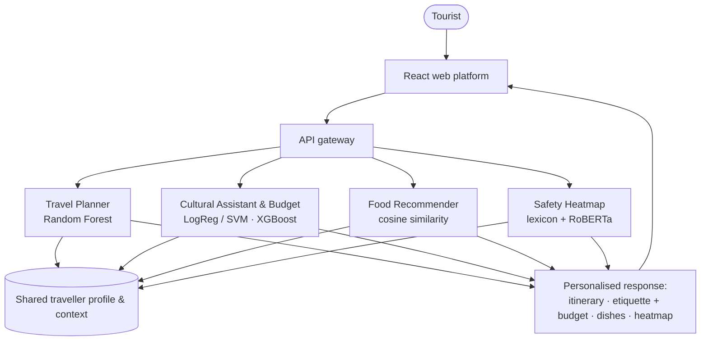

# LostinSriLanka — AI Powered Smart Tourism Ecosystem

**AI-Powered Smart Tourism Assistant for Personalized Travel in Sri Lanka**

| | |
|---|---|
| **Project ID** | R26-IT-022 |
| **Institution** | Sri Lanka Institute of Information Technology (SLIIT) — Faculty of Computing |
| **Specialization** | Information Technology (IT) |
| **Research group** | CoEAI — Centre of Excellence for AI |
| **Module** | IT4010 Research Project — 2026 |
| **Project website** | https://r26-it-022-project-web.vercel.app |

---

## Overview

Sri Lanka welcomed a record 2.36 million tourists in 2025 and targets 3 million in 2026. Yet visitors still stitch a trip together from disconnected tools: a static itinerary app, a guidebook for etiquette, star ratings that hide what went wrong, and no reliable way to know what the trip will cost.

**LostinSriLanka** brings these needs together in one AI-powered platform. Four research components — one per team member — run as independent services behind a shared React frontend and API layer, and cooperate through a shared traveller profile and context.

### Research problem

Tourists lack a single, context-aware tool that tells them **when and where to go**, **how to behave and what it will cost**, **what to eat**, and **what other visitors complain about at a place**.

### Research gap

- Travel planners rely on static schedules instead of predictive crowd and weather models.
- Assistants treat translation, etiquette and budgeting as separate tools rather than one reasoning system.
- Food platforms recommend *places* to eat, not *dishes* matched to an individual's taste and health.
- Review platforms show star ratings; the specific complaints buried in thousands of reviews are never mapped.

---

## Objectives

**Main objective** — Design and develop a unified, AI-powered ecosystem for the Sri Lankan tourism industry that bridges static travel information and real-time, personalized assistance, minimizing traveller uncertainty and enhancing the safety, efficiency and cultural engagement of tourists visiting Sri Lanka.

**Sub-objectives**

1. Predict crowd, weather and disruption to generate adaptive itineraries.
2. Deliver trilingual, etiquette-aware guidance fused with route-based budgeting.
3. Match tourists to dishes via taste-profile and allergen-aware reasoning.
4. Mine tourist reviews for complaints by topic and place, and map them with measured evidence.

---

## Research components

| # | Component | Member | Reg. No. | Core techniques |
|---|---|---|---|---|
| 01 | **AI Events & Travel Planner** | Ekanayaka I.R.U.O | IT22227218 | Random Forest crowd-density regression and weather-impact classification; weighted Recommendation Smart Engine; live re-scoring |
| 02 | **Multilingual Cultural Assistant & Budget Planner** | Costa I.K.I.P | IT22926944 | TF–IDF + Logistic Regression / Linear SVM etiquette-intent classification (English · Sinhala · Tamil text); XGBoost route-based budget estimation |
| 03 | **Personalized Food Recommendation Assistant** | Kalansooriya Y.N | IT22549990 | Continuous taste profiles; content-based filtering with cosine similarity; allergen and health rules; explainable recommendations |
| 04 | **Dynamic Safety Heatmap & Complaint Analytics Engine** | Weerasekara H.B.W.M.T.D | IT22629180 | Opinion-unit segmentation; rule lexicon + RoBERTa topic and complaint/praise classification; country → district → destination aggregation on a map |

### 01 · AI Events & Travel Planner
Forecasts destination-level crowd density and weather impact (Low / Moderate / High) and ranks destinations with a weighted score that also reflects the traveller's free-text preferences:

```
Score(d) = wc·C(d) + ww·W(d) + wp·P(d)      (C = crowd, W = weather, P = preference; weights sum to 1)
```

Served through stateless endpoints so an itinerary can be re-scored as soon as weather, crowd or event data changes.

### 02 · Multilingual Cultural Assistant & Budget Planner
Classifies a tourist's typed question into one of five etiquette intents — dress code, general etiquette, festival guidance, language phrase, photography rules — and returns guidance with a short explanation. A route-based model estimates itemized accommodation, transport/fuel and attraction costs. Voice, image and video input are planned as future work.

### 03 · Personalized Food Recommendation Assistant
Answers *"Will I like this dish, and is it safe for me to eat?"* by matching a taste profile (spice tolerance, sweetness, richness, texture comfort, ingredient familiarity, allergies and diet) against dish-level feature vectors, flagging hidden allergens such as Maldive fish, and explaining each pick with familiar flavour analogies.

### 04 · Dynamic Safety Heatmap & Complaint Analytics Engine
Answers *"What do visitors complain about, and where?"* Reviews are split into single-opinion sentences, sorted into seven topics (roads & access, facilities, cleanliness, safety, price & value, crowding & noise, scenery as a control), classified as complaint, praise or fact, and aggregated from the whole country to 19 districts and 293 destinations, down to the supporting quotes. Every figure shows its evidence count and is hidden below a measured reliability threshold.

---

## Key results

| Component | Task | Model | Result (held-out test set) |
|---|---|---|---|
| 01 Travel Planner | Crowd-density regression | Random Forest (17 features) | R² **0.986**, MAE 4.88, RMSE 5.77 |
| 01 Travel Planner | Weather-impact classification | Random Forest | Accuracy **83.05%**, high-impact recall 0.92 (XGBoost 81.55%, MLP 75.76%) |
| 02 Cultural Assistant | Etiquette-intent classification | Logistic Regression / Linear SVM | Accuracy **100%** (Naive Bayes baseline 97.27%) |
| 02 Budget Planner | Route-based trip-cost regression | XGBoost (selected on validation set) | R² **0.868**, MAE ≈ Rs. 18,992 |
| 04 Safety Heatmap | Topic detection & complaint verdicts on 46,854 reviews | Rule lexicon + RoBERTa | Topic F1 **0.70–0.90**, Cohen's κ 0.72–0.94 vs. two human readers; verdict accuracy 0.40–0.64 |
| 03 Food Recommender | Dish recommendation | Content-based filtering | Evaluation in progress (Precision@K, Recall@K, MAP, allergen recall, SUS) |

Components 01 and 02 follow a strict **70 / 15 / 15** train / validation / test protocol: models and hyperparameters are chosen on the validation split, and test metrics are computed once afterwards.

---

## System architecture



Services: **FastAPI** (reviews & analytics, model serving) and **Flask** (assistance & budget), behind one React frontend.

---

## Technology stack

| Area | Technologies |
|---|---|
| Machine learning | Python, scikit-learn, XGBoost, Random Forest, pandas, NumPy |
| NLP | TF–IDF + linear models, RoBERTa (Hugging Face), sentence-transformers, FAISS, BM25 |
| Backend | FastAPI, Uvicorn, Flask, Pydantic |
| Data | SQLite, MongoDB, Firebase |
| Frontend | React, HTML / SVG map |
| Project website | Next.js, Tailwind CSS, deployed on Vercel |

---

## Repository structure

```text
research/
├── backend/
│   ├── main.py            # backend entry point
│   └── requirements.txt   # Python dependencies (FastAPI, scikit-learn, XGBoost, …)
├── frontend/
│   └── index.html         # web frontend entry point
└── README.md
```

## Getting started

**Prerequisites:** Python 3.10+ and Git.

```bash
git clone https://github.com/thanuxj1/research.git
cd research

# Backend
python -m venv .venv
# Windows: .venv\Scripts\activate    macOS/Linux: source .venv/bin/activate
pip install -r backend/requirements.txt
python backend/main.py

# Frontend
# open frontend/index.html in a browser
```

---

## Team

| Member | Reg. No. | Component | Contact |
|---|---|---|---|
| Ekanayaka I.R.U.O | IT22227218 | AI Events & Travel Planner | it22227218@my.sliit.lk |
| Costa I.K.I.P | IT22926944 | Multilingual Cultural Assistant & Budget Planner | it22926944@my.sliit.lk |
| Kalansooriya Y.N | IT22549990 | Personalized Food Recommendation Assistant | it22549990@my.sliit.lk |
| Weerasekara H.B.W.M.T.D | IT22629180 | Dynamic Safety Heatmap & Complaint Analytics Engine | it22629180@my.sliit.lk |

### Supervision

- **Ms. Lokesha Weerasinghe** — Senior Lecturer, Department of Information Technology (Research Supervisor)
- **Ms. Thamali Dassanayake** — Lecturer, Department of Computer Science
- **Dr. Prasanna Sumathipala** — Assistant Professor, Department of Information Technology

---

## Documents

The Topic Assessment Form, proposal reports, progress presentations and the research paper are available on the [project website](https://r26-it-022-project-web.vercel.app/#documents).

## Ethics

User data is collected only with consent, anonymized before analysis and limited to what the research needs. Cultural content is validated for accuracy and respectful representation, and datasets are checked for linguistic and demographic bias.

## Sustainable Development Goals

SDG 8 — Decent Work & Economic Growth · SDG 9 — Industry, Innovation & Infrastructure · SDG 11 — Sustainable Cities & Communities

---

Developed for academic research purposes — SLIIT IT4010 Research Project, 2026.
